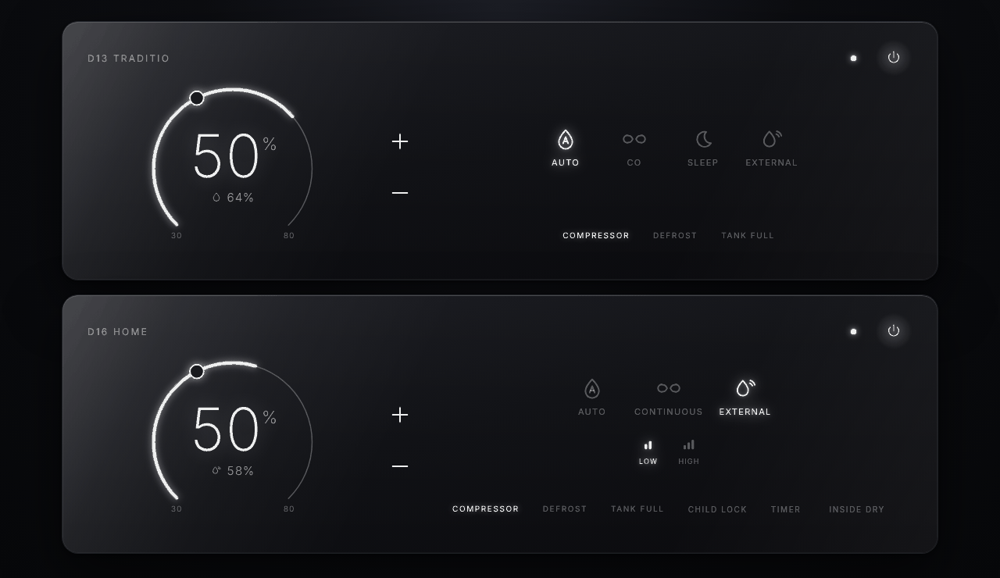
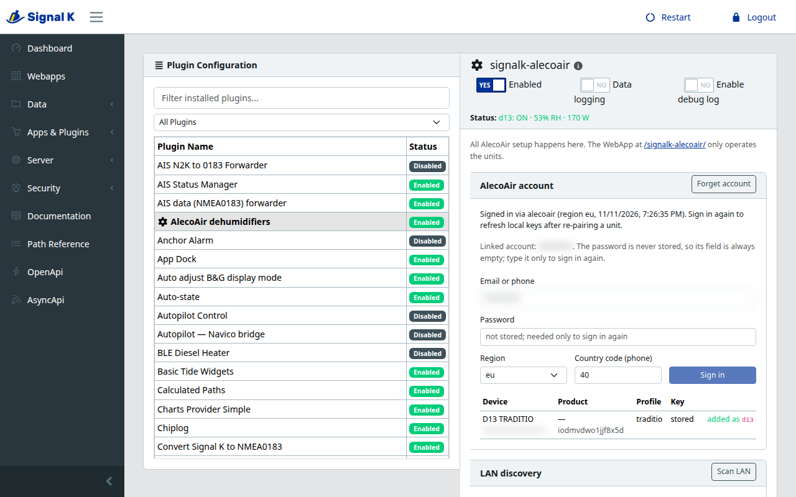

# signalk-alecoair

Signal K plugin and WebApp for AlecoAir Wi-Fi dehumidifiers over Tuya LAN: several units, model profiles, setup in Signal K Admin, no cloud or Node-RED in the control path.

- **Local control.** Each unit is driven over the boat LAN with the Tuya LAN protocol (TCP 6668), protocol 3.5 with automatic fallback 3.5 → 3.4 → 3.3. No Tuya cloud, Node-RED, Home Assistant or MQTT in the command path. The AlecoAir account is used only during setup, to fetch each unit's local key.
- **Several units, one plugin.** Every unit has its own LAN session, Signal K path prefix and model profile (which datapoints, modes and settings it has).
- **Setup only in Signal K Admin**, in the plugin's own configurator: **Apps & Plugins → Configuration → AlecoAir dehumidifiers**.
- **The WebApp is for use only**: control and monitoring at `http://<signalk>:3000/signalk-alecoair/`.

> Version 0.1.0 (unreleased), an early release: only the D13 Traditio has been verified on a real unit. Pure Node.js: no Python or other system packages.

- **External sensor control** (optional, per unit): the plugin can drive a unit from another Signal K humidity sensor, with its own target, hysteresis and minimum on/off times. See [External sensor control](#external-sensor-control).

**Not included yet:** native widgets for SKIP, and starting a heater from the plugin. Both are on the roadmap.

This plugin was developed with Grok Bot.


## Screenshots

The WebApp is for day-to-day control. All setup is in Signal K Admin.





## Supported models

Every Wi-Fi AlecoAir unit is a Tuya dehumidifier (category `cs`), so the LAN transport is the same. The datapoint (DP) layout is not, so each family has a profile. The profile is picked from the Tuya product id that the AlecoAir login returns, or chosen by hand in Plugin Config.

| Profile | Models | Status |
| --- | --- | --- |
| `traditio` | D13 Traditio, D25 Traditio | **Verified** on a live D13 (Tuya LAN 3.5). D25 shares the map per tuya-local, not tested here. |
| `shinco-home` | D12 Home, D16 Home (Shinco family) | Unverified community map (make-all/tuya-local) |
| `d12-eco` | D12 ECO 2.0 | Unverified community map |
| `d16-purify` | D16 Purify (D14 Purify) | Unverified community map |
| `generic` | anything else | Read-only until you map DPs in the inspector |

A unit whose product id matches no profile is **never** given the D13 map. It runs read-only on `generic`; Plugin Config shows what its DPs look like and lets you pick a profile or map DPs yourself.

The plugin only exposes controls that the profile maps **and** the unit actually reports, and it never writes a DP the unit has not reported.

## Install

### Requirements

- A Signal K server (built and tested on signalk-server 2.37) with Node.js 18 or newer. Nothing else: no Python, no compiler, no system packages. The AlecoAir account login runs in Node too, using only Node's built-in modules.
- The dehumidifiers already paired in the **AlecoAir app**, and on the same LAN as the Signal K server.
- The AlecoAir account email (or phone) and password. You do not need to hunt for Tuya device ids or local keys yourself: the plugin reads them from the account when you sign in, once, in Admin.

### Steps

**From the Signal K App Store** (once the package is on npm): in Admin, open **Apps & Plugins → Store**, search for **AlecoAir**, and install `signalk-alecoair`. Then restart Signal K if the server asks you to.

**From npm**, on the Signal K server:

```bash
cd ~/.signalk
npm install signalk-alecoair
sudo systemctl restart signalk
```

**From GitHub**, for development or if you want a checkout you can edit:

```bash
# 1. Get the code and its dependencies
git clone https://github.com/Haimana/signalk-alecoair.git ~/signalk-alecoair
cd ~/signalk-alecoair
npm install --omit=dev

# 2. Install it into Signal K (adds "signalk-alecoair": "file:../signalk-alecoair" to ~/.signalk/package.json)
cd ~/.signalk
npm install ../signalk-alecoair

# 3. Restart Signal K
sudo systemctl restart signalk
```

The entry in `~/.signalk/node_modules` **must be named `signalk-alecoair`**: Signal K loads plugins and mounts webapps by package name.

To update a Git checkout later: `cd ~/signalk-alecoair && git pull && npm install --omit=dev`, then restart Signal K.

The only npm dependency is `tuyapi` (Tuya LAN).


## Configure (Signal K Admin)

1. Open Signal K Admin → **Apps & Plugins → Configuration → AlecoAir dehumidifiers** and enable the plugin.
2. The panel opens with only the **AlecoAir account** sign-in. Enter the **Email or phone** and **Password** of the AlecoAir app where your units appear, pick the **Region** (`eu` for Europe) and, for a phone login, the **Country code** (default `40`). Click **Sign in**.
   Sign-in is needed once, to fetch each unit's local key. A LAN scan can see a unit and its IP without signing in, but status and control over the LAN are encrypted with that per-unit key, which only the account provides. After that, control stays on the LAN with no cloud.
   The password is used once and never stored. After a successful sign-in the email or phone is kept so the panel can show the linked account. Local keys go to the plugin's own store on the server, never into the Admin-visible options.
3. After a successful sign-in the rest of the setup appears. The account's devices are listed with their product id and suggested profile. Click **Add** for each dehumidifier you want; no LAN scan is needed for this.
4. Optional: **Scan LAN** to find or confirm the units' IPs on the network. Leave **LAN IP** empty to let the plugin find the unit at start, or fill it in: an IP set here always wins.
5. For each unit, check:
   - **Name** (a label only) and **Key (paths and API)** — Signal K paths and the REST API use this key. The path prefix and the default estimated power path follow the key whenever you change it and again when you Save, even if the key was first generated from the unit's name when you clicked Add;
   - **Model profile**: *Auto (by AlecoAir product id)* or a profile from the table below;
   - **Model (power estimate)**, if known;
   - **Signal K path prefix** (default `environment.inside.dehumidifier.<key>`), the optional estimated power path and cabin humidity path. Leave the prefix on the default unless you need a custom path; a prefix you type yourself is kept, except that if it ended with the old key, that last segment is updated when the key changes.
6. Click **Save configuration**. Saving restarts the plugin; each unit shows *Connected* once its LAN session is up.
7. Optional: open **DP inspector** on a running unit to see its live datapoints and map unknown ones to roles (useful for unverified or `generic` units).
8. Optional: **Report to GitHub** on a running unit opens a pre-filled issue on [Haimana/signalk-alecoair](https://github.com/Haimana/signalk-alecoair/issues/new). Review the title and the live datapoints, fill in *What works* and *What does not*, then submit from your own GitHub account. The plugin never posts the issue itself and never includes local keys, Tuya device ids, account details, LAN IPs or Signal K paths. The Tuya product id is included on purpose: it is how a new model is identified.


Sign in again whenever you re-pair a unit in the AlecoAir app (re-pairing changes its local key), or when you have added a new unit in the app: it appears in the account table with **Add**, and units already configured keep their Name, Key and paths. **Forget account** drops the device list but keeps the keys of devices that are still configured. **Remove** deletes a unit from the configuration. **Add simulator** adds a fake unit for trying the plugin without hardware; it is available before signing in. If the account was forgotten but units are still configured, the panel shows the full setup and marks any unit without a local key.

You can open Plugin Config and sign in even before the first Save; the setup panel works while the plugin is still unconfigured.

Adding or removing units, credentials and profiles are only in Admin, never in the WebApp.

### Configurator and older servers

The setup panel is a Signal K plugin configurator (`signalk-plugin-configurator`, Module Federation `./PluginConfigurationPanel`), written without a build step: `public/remoteEntry.js` uses the Admin UI's own React. It was built against signalk-server 2.37 (React 19 Admin UI). Servers that do not load configurators fall back to the generic JSON form from the plugin schema, which can edit the device list but cannot sign in or inspect DPs.

## Using the WebApp

Open `http://<signalk>:3000/signalk-alecoair/` (also listed under **Webapps** in Signal K Admin). Every configured unit gets its own card, stacked one under another; `?device=<key>` scrolls to a given unit. The look is inspired by the AlecoAir app, not a copy of it.

Each card shows the unit's real modes for its profile and only the controls the unit actually reports: power, working mode, target humidity, timer, child lock and so on. The D13 Traditio has no fan control, so none is shown for it.

- **Phone / narrow screens (< 960 px):** a compact card per unit with the mode, the humidity ring and −/+ for the target, and a bottom bar (Power, Mode, Fan if present, Settings). Mode, Fan and Settings open a bottom sheet.
- **Desktop (≥ 960 px):** one wide card per unit, stacked vertically. Left: name, status, humidity ring and −/+. Right: Power, the working mode as a dropdown (with fan speed on the same row if the unit has a fan) and the settings in a fixed two-column area. All cards have the same height whatever the model, so units line up and an odd number of units leaves no stray card. Alerts (tank full, defrost, unit not responding) can still make a card taller while they are active.

UI labels are in English.

## External sensor control

A dehumidifier's own hygrostat measures the air right next to the unit. With external control, the plugin uses another Signal K humidity sensor instead (for example a BME280 in the saloon) and drives the unit from it.

How it works:

- The unit is put in its **continuous mode**, so its own hygrostat never stops it: on the Traditio that is Continuous (CO), target `25` on DP 2; on the other families it is the profile's continuous mode. The unit's mode and target from before are remembered and restored later.
- The plugin switches the unit **on** when the external humidity reaches **target + 3%** and **off** at **target − 2%** (both adjustable), with a **minimum on time** and **minimum off time** (10 min each by default) so the compressor is not cycled too often.
- **Defrost:** the plugin never switches the unit off during a defrost (the manual says not to). It waits until the defrost ends. **Tank full** is left to the unit's firmware.
- **Change on the unit:** if the unit's power, mode or target is changed by anything other than the controller (the unit's buttons, the AlecoAir app, the WebApp power button or −/+ of the unit, a Signal K PUT), external control switches off at once. The unit is left exactly as it is: nothing is restored and no command is sent, and the WebApp shows the unit's real mode again. Pick **Auto / external sensor** again to resume.
- **Sensor lost:** when no fresh value has arrived for 5 min (adjustable), the plugin either gives the unit back its own hygrostat (previous mode and target, power on; the default) or switches it off. It takes over again when the sensor is back.
- **Temperature (optional):** with a temperature path, the unit is not started below a minimum temperature (default 5 °C) and is stopped when it gets that cold; it restarts 1 °C above the minimum.
- After a restart the controller picks up where it was: same target, the same on/off choice (the unit is put back to it if the plugin stop restored the hygrostat) and the minimum on/off time counted from the last switch.
- Switching external control off (or turning it off in Admin) restores the unit's own mode and target and switches it on. When the plugin stops while external control is on, the "sensor lost" choice is applied; after a restart, external control resumes with the same target.
- A profile without a continuous mode (D16 Purify) uses the lowest hygrostat target the unit accepts plus power on/off instead. Set the external target above that minimum.
- Values this plugin publishes itself are never used as the external sensor, so a unit's humidity published as cabin humidity cannot feed back.

Setting it up:

1. Signal K Admin → **Apps & Plugins → Configuration → AlecoAir dehumidifiers**, unit card → **External control** → **Allow external control**.
2. **Humidity path**: pick the sensor's Signal K path from the list (paths with "humidity" that the server has seen, with their current value and source) or type one, e.g. `environment.inside.relativeHumidity`. Signal K publishes relative humidity as a ratio 0–1; a percentage (any value above 1.5) is detected too. Each unit uses exactly one sensor; several units may use the same one.
3. Optional: **Temperature path** (Kelvin, as Signal K publishes it) and the minimum temperature.
4. Adjust the hysteresis, minimum times, the stale timeout and what to do when the sensor is lost, or keep the defaults. **Save configuration**.
5. In the WebApp, pick **Auto / external sensor** in the unit's working-mode menu (the Mode sheet on a phone, the working-mode dropdown on a desktop). The entry is there only while external control is allowed in Admin. While it is on, the menu shows it as the selected mode, even though the unit itself is in CO. Picking any other mode (Auto / hygrostat, Continuous, Sleep) leaves external control and sets that mode with the remembered target, power on. The ring shows the external humidity (the unit's own reading is shown below it, smaller), −/+ change the controller target in the unit's own hygrostat steps and range (5% steps, 30–80% on the Traditio; a target set over the API or Signal K is snapped the same way), and a status line says what the controller is doing: running, idle, waiting (minimum time), defrost, sensor missing, too cold or tank full. Hovering the status line shows the reason.

The same can be done from Signal K: `PUT <prefix>.control.mode` = `external` or `internal`, and `PUT <prefix>.control.target` (ratio, e.g. `0.55`). `PUT <prefix>.mode` = `external` also switches it on, and a PUT of any other mode on `<prefix>.mode` leaves it. The published `<prefix>.mode` stays the unit's real mode (`continuous` while external control drives it); `<prefix>.control.mode` says whether external control is on.

## Signal K paths

Each device has its own prefix, taken from its **Key**, not from its Name. Units added in Admin default to `environment.inside.dehumidifier.<key>`. Changing the key in Plugin Config updates that prefix and the default estimated power path immediately and again on Save. A custom prefix is left as you typed it (if it ended with the previous key, only that last segment is replaced).

Under the prefix, only paths the unit actually has are published:

- `.connected`
- `.power`, `.mode`, `.targetHumidity`, `.fanSpeed`, `.childLock`, `.timerHours`, `.sleep`, `.insideDry`: **PUT**
- `.humidity` (ratio 0–1), `.temperature` (K), `.tankFull`, `.defrost`, `.faultCode`, `.timerRemaining` (s), `.compressor` (estimated)
- `.electricalPower` (W, estimated, only when the model's nameplate is known)
- `notifications.<prefix>.tankFull`
- With external control allowed: `.control.mode` (`internal` | `external`) and `.control.target` (ratio): **PUT**; `.control.state`, `.control.reason`, `.control.sourceHumidity` (ratio) and, with a temperature path, `.control.sourceTemperature` (K)

`.mode` has `possibleValues` metadata (e.g. `auto`, `continuous`, `sleep` on Traditio). Optional per device: an estimated power path (default `electrical.loads.dehumidifier<Key>.power`) and a cabin humidity path (off by default for new units).

## API

`http://<signalk>:3000/plugins/signalk-alecoair/devices` lists the units and their state (see `openapi.json`). The setup endpoints (`/plugins/signalk-alecoair/setup/*`) are admin-only.

## Traditio datapoints (D13, verified)

D13 Traditio talks Tuya protocol **3.5** on the LAN. The cloud often returns a WAN IP; the plugin keeps only RFC 1918 addresses.

| DP | Role | Values |
| --- | --- | --- |
| 1 | Power | `true` / `false` |
| 2 | Target humidity | 30–80 step 5; Continuous (CO) is `25` |
| 5 | Mode | `Manual` (hygrostat/CO), `SLeeping` |
| 6 | Measured humidity | % RH |
| 16 | Child lock | boolean |
| 17 | Timer | `cancel`, `1h`…`24h` |
| 19 | Faults | bit 4 = tank full, bit 8 = defrost |

The live D13 reports only these seven DPs. The Traditio profile also maps fan speed to DP 4 (present on the D25 per tuya-local), but it stays hidden on a D13 because the D13 never reports DP 4.

Manual defaults: Manual + hygrostat, CO = continuous via target `25`, restart threshold **target + 1% RH**, 2.3 L tank, 145 / 170 / 195 W.

## Security notes

- Local keys are stored in plaintext in `~/.signalk/plugin-config-data/signalk-alecoair.store.json` (file mode 0600). They are never sent to the browser.
- The setup API (`/plugins/signalk-alecoair/setup/*`) is admin-only when Signal K security is on. The usage API needs read or read/write access.
- The AlecoAir sign-in (`plugin/alecoair.js`) talks to the AlecoAir/Tuya cloud over HTTPS the way the phone app does, using the app's public Tuya client id. If the vendor rotates it, sign-in breaks; LAN control keeps working with the keys already stored. The password is MD5-hashed and RSA-encrypted with a per-login key from the cloud before it is sent, and it is never stored or logged.

## Development

This plugin was developed with Grok Bot.

```bash
npm test
```

Tests use `node --test` and need no hardware or account: fake Tuya LAN devices, the simulator, a fake Signal K app and a local fake of the AlecoAir cloud for the sign-in. Add a profile in `plugin/profiles.js`; mark it `verified: false` until it has been tested on a real unit. Reports and DP maps for the unverified profiles are welcome.

To test external control without a real sensor, write `<configPath>/plugin-config-data/signalk-alecoair.test-sensor.json` on the server, for example `{ "environment.inside.test.relativeHumidity": 0.62 }`. While the file exists, the plugin publishes its values every 2 s (source `signalk-alecoair-test`); only numeric `environment.inside.test.*` paths are accepted. Edit the value to move the humidity, and delete the file to simulate a dead sensor. Use `environment.inside.test.relativeHumidity` as the humidity path in External control.

To treat a known profile as unknown while testing a device report (for example Traditio), set `ALECOAIR_HIDE_PROFILES=traditio` or write the profile id in a `.hide-profiles` file at the plugin root. That file is gitignored; `generic` cannot be hidden. Do not delete the profile from `plugin/profiles.js` for this test.

## Limits

The existing `signalk-tuya` covers sockets, not dehumidifiers. This plugin runs in the Signal K Node.js process. Tuya units allow very few LAN sessions: do not run Home Assistant / tuya-local against the same unit at the same time.

## License

Apache-2.0
